# Cloud99 — Selected Works 2026

网页、界面与视觉设计作品选集。

**Live Site:** https://cl0ud-99.github.io/cloud99-portfolio/

Cloud99 是一个独立设计与前端实践，关注品牌、界面与可交互的网页叙事。作品涵盖品牌站、产品界面、移动端故事与字体实验。

## THE WALL

<a href="poster/poster.png">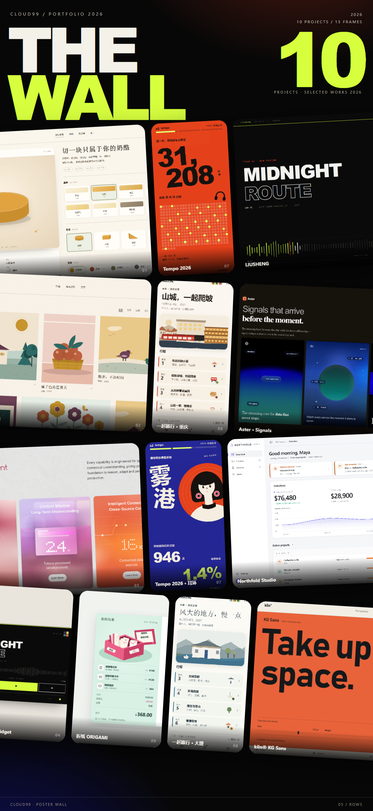</a>

## Projects

<table>
<tr>
<td width="50%"><a href="https://cl0ud-99.github.io/cloud99-portfolio/dsh-backup/cheese-studio/">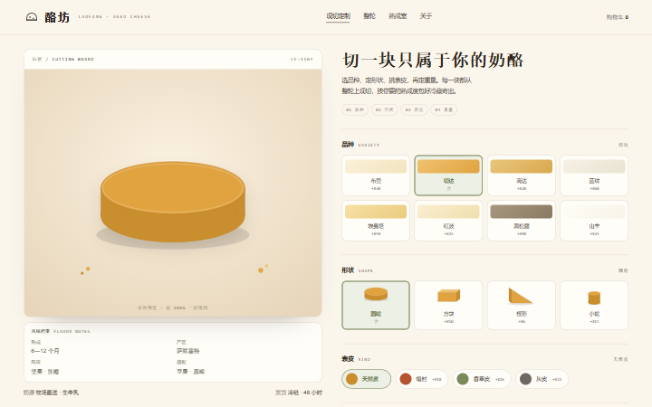</a><br><b>酪坊 LAOFANG</b><br>Brand Site</td>
<td width="50%"><a href="https://cl0ud-99.github.io/cloud99-portfolio/dsh-backup/illustrator-site/">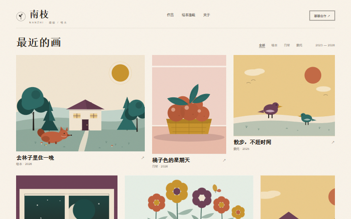</a><br><b>南枝 NANZHI</b><br>Illustration</td>
</tr>
<tr>
<td width="50%"><a href="https://cl0ud-99.github.io/cloud99-portfolio/dsh-backup/intelligent-performance/">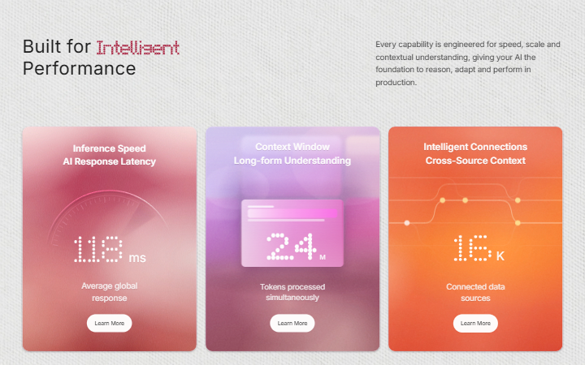</a><br><b>Built for Intelligent Performance</b><br>Product Site</td>
<td width="50%"><a href="https://cl0ud-99.github.io/cloud99-portfolio/dsh-backup/nowplaying/">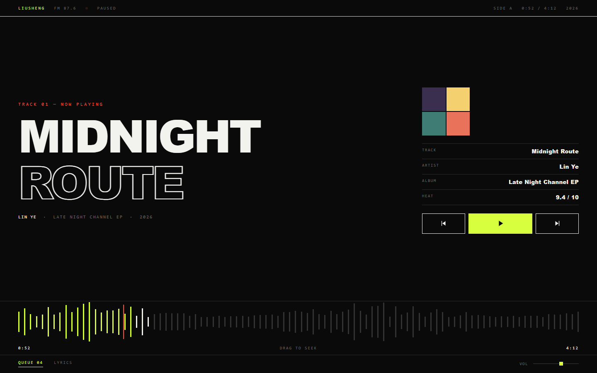</a><br><b>LIUSHENG — Midnight Route</b><br>Music / Poster</td>
</tr>
<tr>
<td width="50%"><a href="https://cl0ud-99.github.io/cloud99-portfolio/dsh-backup/studio-dashboard/">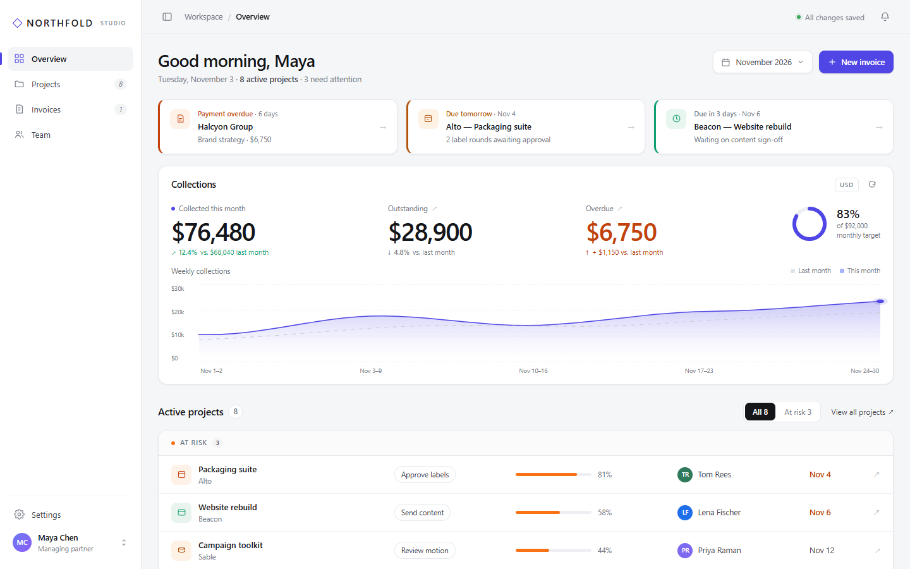</a><br><b>Northfold Studio</b><br>Dashboard</td>
<td width="50%"><a href="https://cl0ud-99.github.io/cloud99-portfolio/dsh-backup/vela/">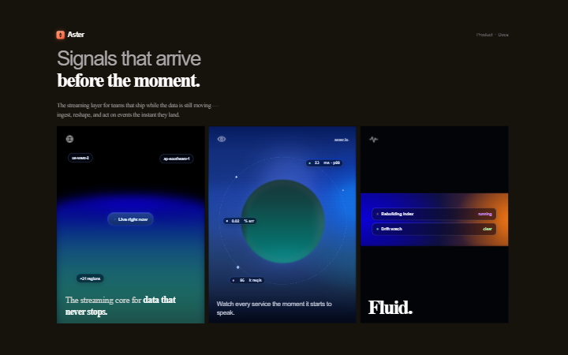</a><br><b>Aster — Signals</b><br>Brand Concept</td>
</tr>
<tr>
<td width="50%"><a href="https://cl0ud-99.github.io/cloud99-portfolio/tempo-wrapped/">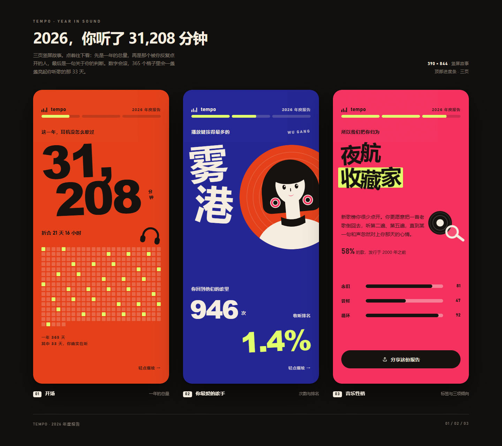</a><br><b>Tempo · 2026 年度报告</b><br>Mobile Story</td>
<td width="50%"><a href="https://cl0ud-99.github.io/cloud99-portfolio/trip-themes/">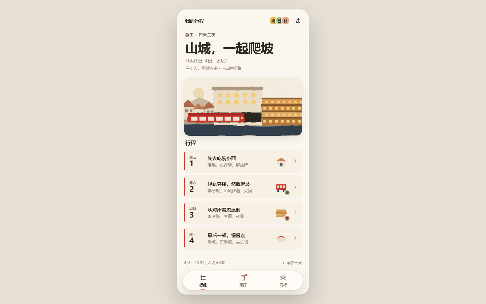</a><br><b>一起旅行 · 三套题材</b><br>Travel App</td>
</tr>
<tr>
<td width="50%"><a href="https://cl0ud-99.github.io/cloud99-portfolio/zhezhi-checkout/">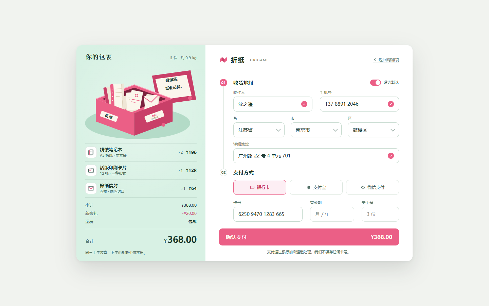</a><br><b>折纸 ORIGAMI · 结账</b><br>E-commerce</td>
<td width="50%"><a href="https://cl0ud-99.github.io/cloud99-portfolio/kiln-foundry/">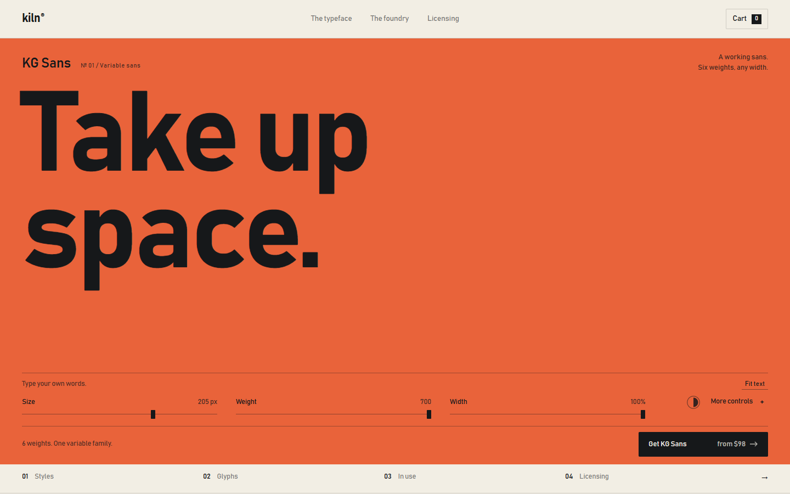</a><br><b>kiln® KG Sans</b><br>Type Foundry</td>
</tr>
</table>

## Local Preview

```bash
python -m http.server 8000
```

Open http://localhost:8000/ 。
